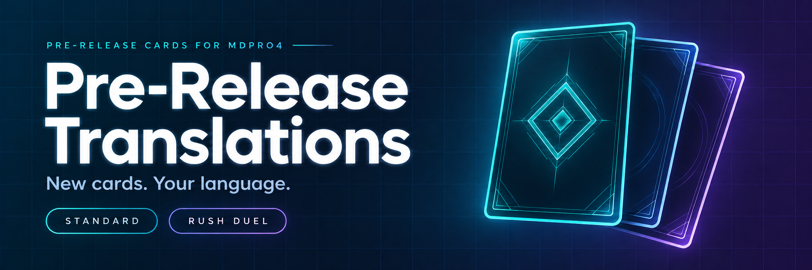

<p align="center">
  
</p>

<p align="center">
  <a href="docs/TRANSLATOR_WORKFLOW.md"><strong>Translator guide</strong></a>
  &nbsp; · &nbsp;
  <a href="docs/RUSH_PRE_RELEASE.md"><strong>Rush Duel guide</strong></a>
  &nbsp; · &nbsp;
  <a href="https://elderlich.github.io/MDPro4_Sacred_Book/"><strong>Card scripting</strong></a>
  &nbsp; · &nbsp;
  <a href="docs/AUTOMATION_SCHEDULE.md"><strong>Daily updates</strong></a>
  &nbsp; · &nbsp;
  <a href="https://github.com/ElderLich/Pre-Release-Translations/actions"><strong>Build status</strong></a>
</p>

<p align="center">
  Translate upcoming cards, review your language, and ship ready-to-play packages for MDPro4.<br>
  One desktop tool for <strong>Standard</strong>, <strong>Rush Duel</strong>, and an overview of every Rush locale.
</p>

---

## Your workspace, at a glance

| Standard | Rush Duel | All locales |
| :--- | :--- | :--- |
| Fetch the latest MyCard cards and translate your selected language. | Refresh your language's Rush database, review the text, and upload your changes. | Review published versions, changed cards, missing translations, and artwork gaps. |
| [Standard workflow →](docs/TRANSLATOR_WORKFLOW.md) | [Rush workflow →](docs/RUSH_PRE_RELEASE.md) | [Maintainer builds →](docs/RUSH_PRE_RELEASE.md#maintainer-all-locale-builds) |

The interface follows your selected language by default. **Settings** lets you choose a different interface language and locate DataEditorX. The activity panel switches between a compact animated bar and the full log.

## Start translating

### 01 · Set up once

Install [Python 3](https://www.python.org/downloads/), [Git](https://git-scm.com/downloads), and a database editor such as [DataEditorX](https://github.com/ElderLich/DataEditorX) or [DB Browser for SQLite](https://sqlitebrowser.org/dl/). Clone this repository with Git or [GitHub Desktop](https://desktop.github.com/).

Create a separate local language folder, then copy this launcher into it:

| From this repository | Into your local folder, for example `FR/` |
| :--- | :--- |
| [Tools/AutoPR_local.py](Tools/AutoPR_local.py) | `AutoPR.py` |

Use `DE`, `EN`, `ES`, `FR`, `IT`, `JP`, `KR`, `PT`, or `TH` as the folder name. Open **AutoPR.py**; on Windows it automatically opens the GUI without a console window. Select your Pre-Release Translations checkout when prompted. Your folders can live wherever you prefer. If you previously installed both launchers, remove the old `AutoPR.pyw` after updating `AutoPR.py`.

### 02 · Fetch and translate

Choose **Standard** or **Rush**, select your language, and fetch updates. Then use **Open Database in DataEditorX** to edit card names, effects, and in-game prompts. Save your edits in the editor.

| Selected tab | Your local working database |
| :--- | :--- |
| Standard | `<LANG>/raw2/test-release.cdb` |
| Rush | `<LANG>/Rush/raw2/rush-pre-release.cdb` |

For Standard archetype and prompt strings, also edit `raw2/test-strings.conf` when needed. Keep card IDs and gameplay values unchanged.

### 03 · Review and publish

Review your local translations, then use **Upload workspace & push to GitHub** when they are ready. You need repository write access to push. GitHub Actions builds the packages and metadata from your workspace.

> [!TIP]
> Rush translators need Python, Git, this repository, and their language folder. The cloud build obtains the Rush source and locale databases; a separate `ygopro-rush-duel` or MDPro4_Data checkout is only needed for maintainer builds.

> [!NOTE]
> This repository was renamed from TransSuperpre. Its old download URLs are retired. Existing translator checkouts can keep their folder names; follow the [remote migration instructions](docs/TRANSLATOR_WORKFLOW.md#local-setup-for-translators) to update an older checkout.

The [full translator guide](docs/TRANSLATOR_WORKFLOW.md#local-setup-for-translators) covers setup, conflict resolution, reports, and the legacy `AutoPR.py --menu` interface.

**Spanish on Android/Termux:** [Zane's mobile helper](Tools/Zane_Tests/README.md) uses numbered menus and downloads only changed workspace files. It does not need a GUI or a full repository clone.

## Languages & card text

**Standard packages:** [DE](DE) · [EN](EN) · [ES](ES) · [FR](FR) · [IT](IT) · [JP](JP) · [KR](KR) · [PT](PT) · [TH](TH) · [ZH-TW](ZH-TW)

**Rush packages:** all of the above, plus [ZH-CN](ZH-CN) — **11 locales**.

| Language / source | How Rush text is maintained |
| :--- | :--- |
| English | Missing names and effects are fetched from Yugipedia. |
| French | Yugipedia first, with verified CodexYGO matches when French text is incomplete. |
| Japanese | Missing text is matched against the Rush lists on ocg-card.com. |
| Korean | Translator-maintained text; no Korean web fetching. |
| Thai | Follows English. Submit Rush text corrections through EN. |
| Simplified Chinese | Follows upstream `RD Patch.cdb`; the workspace is reference-only. |
| Other Rush locales | Existing workspace translations and locale seed databases, completed by translators. |

Standard also supports automatic English and French source text. Existing translator edits take precedence; incomplete source text remains pending for review. See [automatic card text](docs/TRANSLATOR_WORKFLOW.md#automatic-english-and-french-card-text) for matching rules and reports.

**Traditional Chinese:** Standard uses its [dedicated workflow](.github/workflows/autopr-zh-tw.yml) and `ZH-TW/Base Files`. Rush uses the editable `ZH-TW/Rush/Workspace` database. See the guides before editing either.

## What the automation handles

- **Fresh inventory.** New upstream cards enter the workspaces; retired cards leave them. Rush inventory follows `RD Patch.cdb` and the reviewed exclusions.
- **Translation review.** Rush preserves local text edits and reports conflicting changes. Each completed language releases independently; languages still awaiting translation keep their previous packages.
- **Shared artwork.** Files in [Shared/Rush Artworks](Shared/Rush%20Artworks) are included in every locale's Rush package. Missing artwork appears in the reports.
- **Daily updates.** One dispatcher checks what needs updating. Standard locales released within 24 hours skip scheduled imports unless the upstream package is newer. Rush checks source revisions and local inputs.
- **Game packages.** Successful builds produce `.ypk` packages, JSON card data, and version files.

[Read the schedule rules →](docs/AUTOMATION_SCHEDULE.md) &nbsp; [Inspect workflow runs →](https://github.com/ElderLich/Pre-Release-Translations/actions)

<details>
<summary><strong>Repository map & package names</strong></summary>

```text
Pre-Release-Translations/
├── Tools/                       Desktop tool, launchers and builders
├── Shared/
│   ├── Mappings.csv             Shared card-name and prompt bindings
│   ├── Rush/                    Rush configuration and source snapshots
│   └── Rush Artworks/           Artwork shared by every Rush locale
├── <LANG>/
│   ├── Workspace/              Standard translation inputs
│   ├── Base Files/             Standard build inputs (see ZH-TW exception)
│   ├── Rush/Workspace/         Rush translation inputs
│   ├── ygopro-super-pre.ypk    Standard package
│   └── rush-pre-release.ypk    Rush package
└── docs/                        Setup, translation and automation guides
```

Standard metadata uses `test-release.json` and `version.txt`. Rush uses `rush-pre-release.json` and `rush-version.txt`. Package availability follows the language lists above.

Edit your working database and upload its workspace. Packages, metadata, source snapshots, and text dumps are generated by the tools.

</details>

## Learn card scripting

Visit [MDPro4 Sacred Book](https://elderlich.github.io/MDPro4_Sacred_Book/) to learn card scripting for MDPro4. Keep it open alongside [DataEditorX](https://github.com/ElderLich/DataEditorX) while writing and editing Lua card effects.

## Credits & sources

Project led and documented by **Senator John**. Original translation tool by **@Reinen** of *The Wire Forest*.

Card data and translation references: [MyCard Super-Pre](https://mycard.world/ygopro/arena/index.html#/superpre), [Rush Duel upstream](https://code.moenext.com/mycard/ygopro-rush-duel), [Yugipedia](https://yugipedia.com/), [YGOrganization](https://ygorganization.com/), [CodexYGO](https://codexygo.fr/api/card/v1/docs/?lang=en), and [ocg-card.com](https://ocg-card.com/list_r/).

---

<p align="center"><sub>Fetch the latest cards. Make the text feel at home. Share it with your players.</sub></p>
